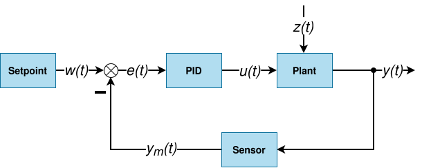

Theory
======

The program identifies the plant in this loop, then replaces the proportional
controller with the PID in :mod:`pid` and searches its gains. The symbols
below are the ones on the drawing, and the same letters are used in
:meth:`pid.controller.PID.step` and :meth:`plantid.plant.Plant.step`.

   Closed loop used for identification and tuning.

Signals
-------

.. list-table::
   :header-rows: 1
   :widths: 15 25 60

   * - Symbol
     - On the drawing
     - In the log and the code
   * - :math:`w(t)`
     - Setpoint
     - ``set_point``. Passed to :meth:`~pid.controller.PID.step` as ``w``.
   * - :math:`y_m(t)`
     - Sensor output
     - ``measure_value``. Passed to :meth:`~pid.controller.PID.step` as ``ym``.
   * - :math:`e(t)`
     - Summing junction
     - Computed as :math:`w(t) - y_m(t)`. Not a required log column.
   * - :math:`u(t)`
     - PID output
     - Controller command. Returned by :meth:`~pid.controller.PID.step` and passed to :meth:`~plantid.plant.Plant.step` as ``u``.
   * - :math:`z(t)`
     - Disturbance into the plant
     - Not in the log. Identification and tuning use :math:`z(t) = 0`.
   * - :math:`y(t)`
     - Plant output
     - Returned by :meth:`~plantid.plant.Plant.step`.

The circle subtracts the sensor reading, which is the minus mark on the
return path:

.. math::

   e(t) = w(t) - y_m(t)

The PID block turns :math:`e(t)` into :math:`u(t)`. Coulomb friction sits on
the plant input, before the linear dynamics. With :math:`z(t) = 0` the plant
sees :math:`u(t)`:

.. math::

   u_e(t) =
   \begin{cases}
   0 & \text{if } |u(t)| < F_c \\
   u(t) - F_c \operatorname{sign}(u(t)) & \text{otherwise}
   \end{cases}

:math:`u_e(t)` drives :math:`G(s)`, whose output is :math:`y(t)`. The sensor
is drawn separately, but it is not fitted. In the simulator the sensor is the
identity, so :math:`y_m(t) = y(t)`. The log already stores :math:`y_m`, and
the fitted plant is the path from :math:`u` to that measurement.

Two plant families are fitted. An inertial plant of order :math:`n` is

.. math::

   G(s) = \frac{K}{(\tau_1 s + 1)\cdots(\tau_n s + 1)}

An integrator with :math:`n` lags is

.. math::

   G(s) = \frac{K_v}{s\,(\tau_1 s + 1)\cdots(\tau_n s + 1)}

:math:`F_c = 0` removes the dead-zone. Time constants are real and positive.

Identification
--------------

The log is this loop running with a proportional controller, so the PID block
is :math:`u(t) = K_p e(t)` while the data were collected. :math:`K_p` is
``identify.kp`` in the config. It is not fitted.

:meth:`plantid.log.Log.identify` tries the catalog: inertial orders 1–3, with
and without friction, then integrators with 0, 1, and 2 lags and friction.
Each candidate is simulated on the logged time base with
:math:`u(t) = K_p (w(t) - y(t))` and :math:`z(t) = 0`, including the input
dead-zone. lmfit minimizes the error between :math:`y(t)` and
``measure_value``. The lowest RMSE is written to ``model/plant.json`` as
``kind``, ``gain``, ``taus``, and ``fc``.

Tuning
------

:meth:`pidtune.tune` loads that plant and puts :meth:`pid.controller.PID.step`
in the PID block. The sample time is ``tune.dt``. Each step computes
:math:`u(t)` from :math:`w(t)` and :math:`y_m(t)`, with :math:`y_m(t) = y(t)`,
then advances the plant by one zero-order hold. :math:`z(t)` stays 0.

The shipped controller clears :math:`e(t)` inside its dead zone, clamps the
accumulator, and clips :math:`u(t)`. That law lives in
``src/pid/controller.py``. Replacing :meth:`~pid.controller.PID.step` changes
the PID block in the drawing; the plant and the feedback path stay as they are.

The search minimizes the integral of squared error :math:`(w - y)^2` on the
levels in the config. It does not identify the plant again.
